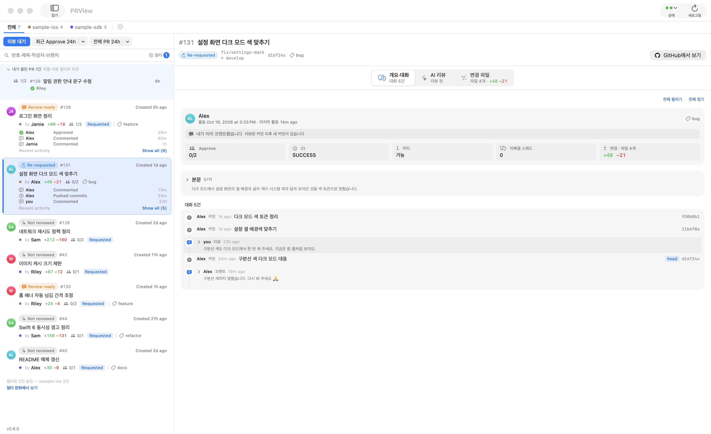
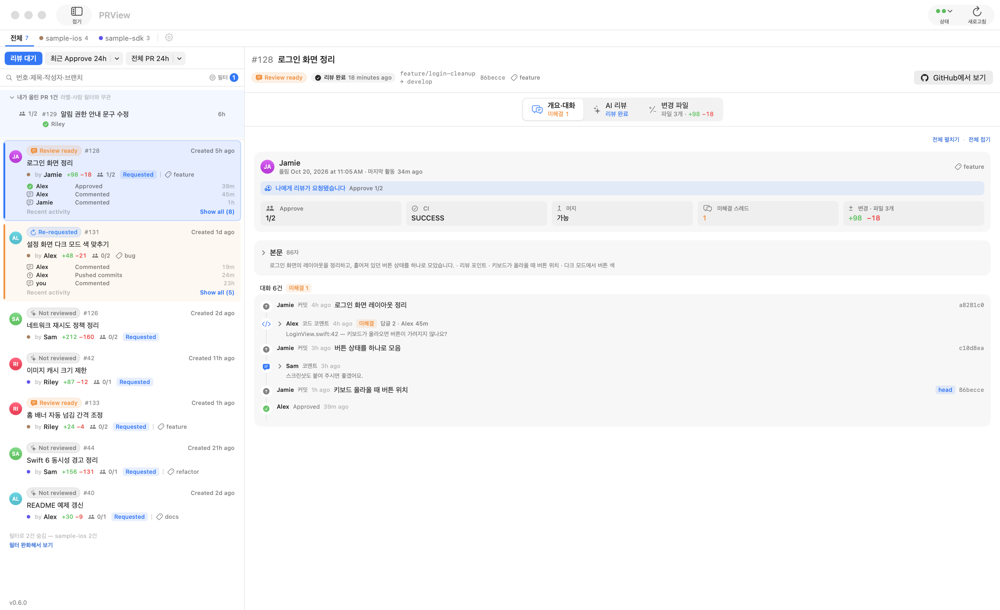
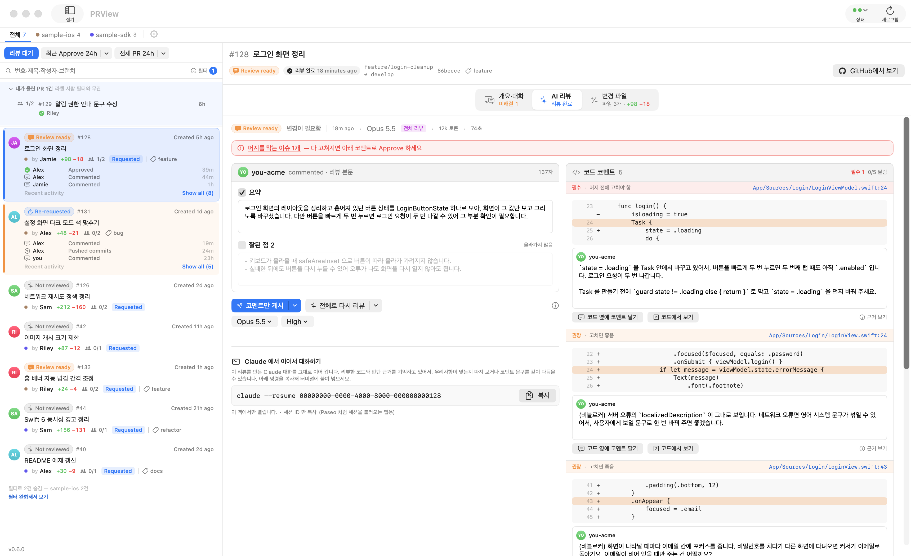
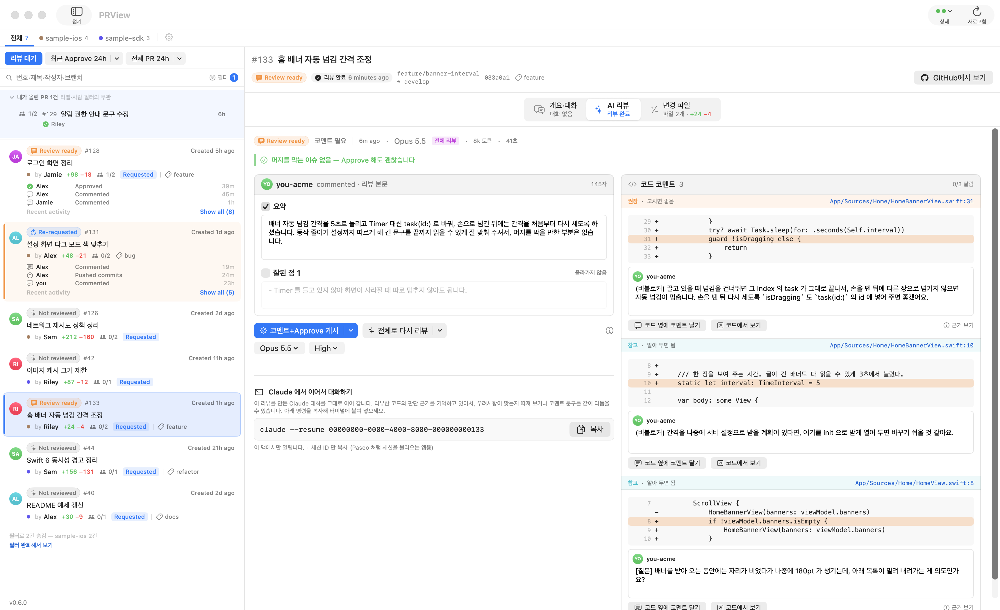
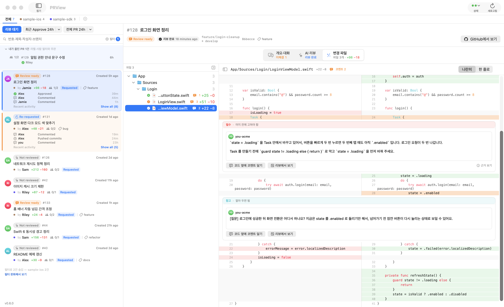

# PRView - PR Review Manager

팀 GitHub PR 을 한눈에 보고, **내 맥에 설치된 Claude Code** 로 리뷰 초안을 만들고,
내가 확인한 것만 GitHub 리뷰로 올리는 macOS 앱입니다.

이 저장소에는 **배포본만** 있습니다 — [릴리스](https://github.com/terry-yes/PRView/releases/latest)의 앱 zip 과 설치 스크립트.

> PRayer 를 쓰던 분은 따로 할 일이 없습니다. 앱에서 0.6.0 으로 업데이트하면 이름이 PRView 로 바뀌고, 그 뒤 업데이트는 이 저장소에서 받습니다.

## 화면

### PR 목록



리뷰를 기다리는 PR과 내가 올린 PR을 한 목록에서 봅니다. 내가 리뷰한 뒤 새 커밋이 올라오면 `Re-requested` 로 알려 줍니다.

### 개요·대화



PR 정보와 본문, 커밋·코드 코멘트·리뷰가 오간 흐름을 시간순으로 봅니다.

### AI 리뷰



왼쪽은 리뷰 본문, 오른쪽은 코드 줄에 달 코멘트입니다. 코멘트는 필수·권장·참고로 나뉘고, 머지를 막는 이슈(필수)가 있으면 위에 붉은 줄로 알려 주며 그 코멘트를 맨 위에 모읍니다.



막는 이슈가 없으면 초록 줄로 Approve 해도 괜찮다고 알려 줍니다. 남은 코멘트는 권장·참고입니다.

### 변경 파일



바뀐 파일을 나란히 보고, 코드 코멘트는 그 줄 바로 아래에 펼쳐집니다.

<sub>화면의 저장소·PR·사람 이름은 모두 데모용 가짜 데이터입니다.</sub>

## 설치 · 업데이트

터미널에 한 줄이면 `gh` 확인, 앱 내려받기, 설치까지 합니다. 업데이트도 같은 명령입니다.

```bash
curl -fsSL https://raw.githubusercontent.com/terry-yes/PRView/main/Scripts/setup.sh | bash
```

설치한 뒤에는 새 버전이 나오면 창 위에 안내가 뜹니다 → `앱에서 업데이트`

## 필요한 것

- macOS 14 이상, Apple Silicon
- [Claude Code](https://code.claude.com) 설치·로그인 — `claude auth login`
- [GitHub CLI](https://cli.github.com) 로그인 — `gh auth login`

앱은 토큰을 따로 저장하지 않고 이 맥의 `gh`·`claude` 로그인을 그대로 씁니다.
리뷰 초안은 이 맥에서만 만들어지고, 직접 게시 버튼을 눌러야 GitHub 에 올라갑니다.
